<div align="center">

```text
┌─────────────────────────────────────────────────────────────┐
│  ks1686@github ~                                            │
│  $ whoami                                                   │
│  Karim Smires                                               │
│  builder · systems · open source                            │
└─────────────────────────────────────────────────────────────┘
```

**Associate Software Engineer @ Guild** · M.S. Machine Learning @ Rutgers · building cross-platform dev tools, AI gateways, and health and IoT apps

[pea-pod.me](https://pea-pod.me/) · [Resume](https://pea-pod.me/resume/) · [LinkedIn](https://www.linkedin.com/in/karim-smires/) · [Email](mailto:k.smires101@icloud.com)

<br/>

<a href="https://github.com/ks1686">
  <picture>
    <source media="(prefers-color-scheme: dark)" srcset="./profile/stats-dark.svg" />
    <source media="(prefers-color-scheme: light)" srcset="./profile/stats.svg" />
    
  </picture>
</a>
<a href="https://github.com/ks1686">
  <picture>
    <source media="(prefers-color-scheme: dark)" srcset="./profile/top-langs-dark.svg" />
    <source media="(prefers-color-scheme: light)" srcset="./profile/top-langs.svg" />
    
  </picture>
</a>

</div>

---

## Featured projects

### [genv](https://github.com/ks1686/genv): Global Environment Manager
Track, sync, and reproduce your software environment across macOS, Windows, Arch Linux, Ubuntu-like Linux, and WSL2. A thin layer over the package managers you already use, driven by one git-friendly `genv.json`.

```bash
brew tap ks1686/tap && brew install --cask genv
genv add git && genv apply --dry-run
```

[Docs](https://pea-pod.me/genv/) · [Homebrew tap](https://github.com/ks1686/homebrew-tap) · **Go**

### [peaproxy](https://github.com/ks1686/peaproxy): Local multi-provider AI gateway
One localhost endpoint for coding tools: OpenAI-, Claude-, and Responses-shaped APIs over API keys, local runtimes, and optional subscription OAuth, with a live model catalog, 429/401 failover, OS keychain secrets, a CLI, and a browser UI.

```bash
brew tap ks1686/tap && brew install --cask peaproxy
peaproxy serve
```

[Docs](https://pea-pod.me/peaproxy/) · **Go**

### [rutgers-health-services-app](https://github.com/ks1686/rutgers-health-services-app): CWC Health App
Flutter pilot for CSPNJ Community Wellness Centers (Rutgers BHEI), Android and iOS. Nearby services from OpenStreetMap, on-device health records, a persistent Help Now control, and no accounts or third-party analytics. CI runs format, analyze, tests, and APK builds on every PR. Paper submitted to IEEE HMSS 2026.

**Flutter** · Dart · Android · iOS

### [DrinkSync](https://github.com/ks1686/DrinkSync): Sustainable hydration tracking
Low-cost IoT smart coaster and Kotlin Android app. A Raspberry Pi (HX711 load cell, MPU6050 gyro) detects each sip and sends it to the phone over Classic Bluetooth RFCOMM. Rutgers capstone, described in a co-authored [IEEE publication](https://ieeexplore.ieee.org/document/11449671/).

**Kotlin** · Python · Raspberry Pi · IEEE

### [psych-cert-automator](https://github.com/ks1686/psych-cert-automator): CE Certificate Automator
Desktop app for the Rutgers GSAPP Psychology Department that matches Zoom attendance to Qualtrics CE surveys and generates per-person PDF certificates. Offline installers for macOS, Windows, and Linux.

**Python** · Tauri

### [pea-pod](https://github.com/ks1686/pea-pod): Personal project hub
Dependency-free static site (HTML, CSS, vanilla JS) for project docs and my resume, served on Cloudflare Workers.

[pea-pod.me](https://pea-pod.me/) · **JavaScript** · Cloudflare Workers

---

## Stack

**Languages**: Python · TypeScript / JavaScript · Go · Java · Kotlin · C / C++ · C# · Swift · Rust · SQL · MATLAB · Verilog

**Cloud & infra**: AWS · Docker · GitHub Actions · Cloudflare

**AI / ML**: PyTorch · TensorFlow · Hugging Face · OpenCV · CUDA · LLMs · NLP · computer vision · RL

<p align="center">
  
  
  
  
  
  
  
  
</p>

---

## Contribution snake

<div align="center">
  <picture>
    <source media="(prefers-color-scheme: dark)" srcset="https://raw.githubusercontent.com/ks1686/ks1686/main/profile/github-snake-dark.svg" />
    <source media="(prefers-color-scheme: light)" srcset="https://raw.githubusercontent.com/ks1686/ks1686/main/profile/github-snake.svg" />
    
  </picture>
</div>

---

<div align="center">

`cat contact.txt`

**k.smires101@icloud.com** · [linkedin.com/in/karim-smires](https://www.linkedin.com/in/karim-smires/) · [pea-pod.me/resume](https://pea-pod.me/resume/)

</div>
